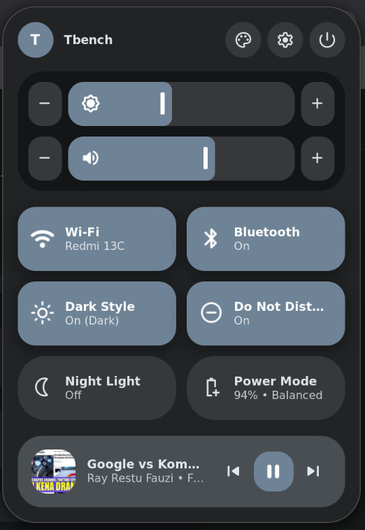
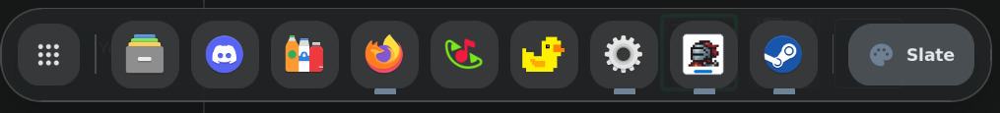
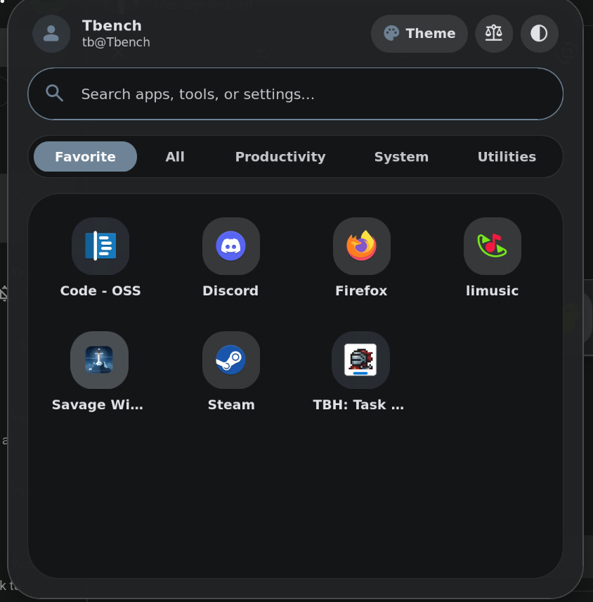
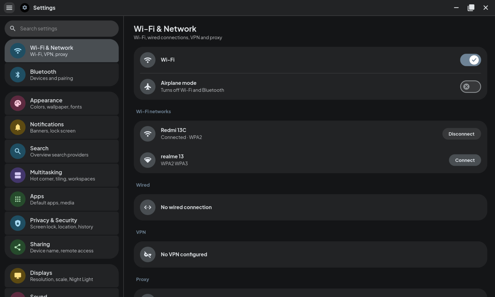

# Material 3 for GNOME Shell

A Material 3 (Android 17 / Material You) component suite for GNOME Shell 51.
The suite is modular; Quick Settings is the first completed feature.

## Screenshots

**Quick Settings** — capsule sliders, expressive tiles, media card:



**Dock** — floating pill dock with running indicators and the palette button:



**App menu** — search, category pills, app grid and theme/power buttons:



**Settings** — GTK 4 replacement for GNOME Settings:



## Quick Settings

A 1:1 static replica of the lavender Android 17 Quick Settings panel:

- 360 px panel, 32 px radius, Material tonal surface + outline, light/dark
- User header (avatar, name, subtitle, settings, close)
- Grouped brightness/volume capsule sliders: −/+ step buttons, primary fill,
  thumb bar, percentage badge. Optional *Handle* style: thick track split by a
  vertical handle, with round buttons after it
- 2 × 3 expressive quick toggles (Wi-Fi, Bluetooth, Dark Style, Do Not Disturb,
  Night Light, Power Mode), active state with 18 px radius
- Media card with cover, title, subtitle and transport controls. Optional
  *Cover* style: album art fills the card, with a seek bar and shuffle

Light/dark follows `org.gnome.desktop.interface color-scheme` and is applied
live; no shell restart is needed for the mode switch.

### Interactions (1:1 with the reference HTML)

- **Sliders**: press and drag anywhere on the capsule, scroll, or use
  Left/Right/Up/Down/Home/End/PageUp/PageDown. -/+ step by 10. Held state:
  radius 16 -> 22 (spring), thumb bar 4x22 -> 3x28, icon scale 1.15 and
  rotate -8deg (bounce). Icon and value badge follow the value.
- **Tiles**: radius 28 <-> 18 (bounce), fill and text colors fade, icon scale
  1.12 when active, pop 0.93 -> 1.03 -> 1, press scale 0.94.
- **Buttons / media controls**: press scale 0.95 (bounce); -/+ buttons 0.9.
- The reference `--spring-ease` / `--bounce-ease` cubic-beziers are evaluated
  in `animation.js` (St itself cannot overshoot or interpolate radius).

### Live system state

| Control        | Source                                                        |
| -------------- | ------------------------------------------------------------- |
| Brightness     | `Main.brightnessManager.globalScale` (overlay if no backlight) |
| Volume         | shared `Gvc.MixerControl` default sink                         |
| Wi-Fi          | NetworkManager `WirelessEnabled`, active SSID                  |
| Bluetooth      | GnomeBluetooth + rfkill airplane mode                          |
| Dark Style     | `org.gnome.desktop.interface color-scheme`                     |
| Do Not Disturb | `org.gnome.desktop.notifications show-banners` (inverted)      |
| Night Light    | `org.gnome.settings-daemon.plugins.color night-light-enabled`  |
| Power Mode     | `org.freedesktop.UPower.PowerProfiles` + battery percentage    |
| Media          | shell `MprisSource` (play/pause/next/previous)                 |

A backend that cannot start is replaced by an inert one: its tile is dimmed
and disabled instead of breaking the panel.

## Dock dan app menu

Dock melayang di bawah layar dan app menu (App Drawer) yang dibukanya, 1:1 dengan
`android_17_material_you_desktop_os.html`:

- **Dock**: pill 64 px, radius 28. Tombol menu aplikasi, ikon aplikasi favorit +
  aplikasi yang sedang berjalan, dan tombol penutup pilihan (`dock-end-button`:
  tidak ada, ganti tema, atau pintasan pengaturan). Indikator di bawah ikon: tidak
  ada (tertutup), titik 6 px (diminimalkan), garis 16 px (terbuka). Klik: buka jika
  tertutup/diminimalkan, minimalkan jika sedang fokus; klik tengah membuka jendela
  baru. Animasi minimize terbang ke ikon dock, lalu ikon memantul
  (`dockAbsorbBounce`). Hover ikon menampilkan pratinjau jendela, ukurannya diatur
  `preview-scale`.
- **App menu**: popover 480 px di atas dock (radius 32) dengan header "Semua
  Aplikasi" + tombol Tema dan mode terang/gelap, kolom pencarian (Enter membuka hasil
  pertama), pil kategori (Semua / Produktivitas / Sistem / Utilitas dari kategori
  desktop entry), grid 4 kolom dengan animasi muncul bertahap, dan kartu
  "Lanjutkan Terakhir" (jendela yang terakhir dipakai). Urutan aplikasi mengikuti
  `appmenu-sort` (nama A-Z, nama Z-A, atau paling sering dipakai). Klik di luar
  atau `Esc` menutupnya.
- Mengikuti palet (aksen GNOME), mode terang/gelap, skala UI dan font yang sama
  dengan Quick Settings. Dock disembunyikan di Overview dan layar penuh. Overview saat login dilewati, dan dash bawaan Overview disembunyikan.
- Nonaktifkan di pengaturan extension -> "Dock and app menu" -> "Show dock"
  (`show-dock`).

```
features/dock/
  index.js     pemasangan, posisi, sinyal shell, tema/mode/skala
  dock.js      pill dock, item aplikasi, indikator, bounce, ikon minimize
  appMenu.js   popover app menu (header, pencarian, kategori, grid, saran)
  apps.js      daftar aplikasi terpasang dan pemetaan kategori
```

### Menu konteks, ukuran app menu, dan power mode

- **Menu konteks** (klik kanan ikon dock atau kartu aplikasi) menutup sendiri saat
  klik di luarnya. Klik itu hanya menutup menu dan tidak diteruskan ke yang ada di
  bawahnya. Tampilannya punya pengaturan sendiri: font (`context-font-family`;
  kosong = sama dengan font utama), ukuran menu (`context-scale`) dan ukuran teks
  (`context-font-scale`) 0.7–1.6, serta tampil/tidaknya ikon tiap entri
  (`context-show-icons`). Border menu punya grupnya sendiri
  (`border-ctx-width`, `border-ctx-radius`, `border-ctx-color`).
- **App menu**: lebar (`appmenu-width`, 360-900 px; kartu aplikasi membagi lebarnya
  sama rata) dan tinggi grid (`appmenu-height`) punya pengaturan terpisah di
  "Dock and app menu".
- **Power mode**: tombol di header app menu, di samping tombol Tema. Mengkliknya
  membuka pop-up Performance / Balanced / Power Saver (profil aktif diberi tanda
  centang, ikon tombol mengikuti profil). Tombol tersembunyi jika
  power-profiles-daemon tidak tersedia.

## Desktop icons

`show-desktop-icons` draws the files of the Desktop folder right on the
wallpaper, with no other extension needed. The icons sit on a grid between the
wallpaper and the windows: a click selects, a double click opens, dragging moves
(positions are kept in `desktop-positions`), dragging on the wallpaper draws a
selection rectangle, and the right button opens the extension's own menu (open,
cut / copy / paste, rename, properties, new folder or document, change
background). Home and Trash shortcuts can be added (`desktop-show-home`,
`desktop-show-trash`), and the icon size is `desktop-icon-size` (32–128 px).

## Date menu

The clock menu in the top bar is replaced with the Material 3 date menu
(`show-datemenu`): notifications on the left, and a calendar, reminders, world
clocks and weather on the right. Reminders are stored in GSettings
(`datemenu-notes`) keyed by date. Panel and text size scale independently
(`datemenu-scale`, `datemenu-font-scale`, 0.7–1.5).

## Alt+Tab switcher

`show-switcher` replaces the shell's window switcher with a Material 3 picker:
one card per window with the app icon, title, close button and a live preview
sized from the window's own aspect ratio, plus the workspace hint. Off restores
GNOME's own switcher.

## Pengaturan (pengganti GNOME Settings)

Aplikasi GTK 4 asli (`app/`, dijalankan `gjs -m app/main.js`), jadi tiling, snap, resize,
drag, dan scrollbar ditangani compositor. Tampilan mengikuti HTML (sidebar pil, kartu,
switch M3, slider ekspresif). 21 halaman: Wi-Fi & Jaringan, Bluetooth, Tampilan,
Notifikasi, Pencarian, Multitasking, Aplikasi, Privasi, Berbagi, Layar, Suara, Daya,
Mouse & Touchpad, Keyboard, Pintasan Keyboard, Pengaturan Lainnya, Tanggal & Waktu,
Wilayah & Bahasa, Aksesibilitas, Penyimpanan, Tentang. Halaman Font & Tema dibuka dari
Tampilan. Nilai dibaca/ditulis lewat GSettings (sama dengan perintah `gsettings`),
plus nmcli, bluetoothctl, wpctl, timedatectl, D-Bus Accounts, lpstat/colormgr/boltctl.

- Extension membuat `~/.local/share/applications/org.gnome.Settings.desktop` (override),
  menyembunyikan entri panel GNOME Settings, dan menonaktifkan search provider-nya.
  Semua dihapus saat "Replace GNOME Settings" (`show-settings`) dimatikan.
- Halaman "Pengaturan Lainnya" membaca pengguna, printer, akun online, profil warna
  dan perangkat Thunderbolt langsung dari D-Bus / `lpstat` / `colormgr` / `boltctl`,
  lengkap dengan aksi ganti nama, printer default, dan otorisasi Thunderbolt.
  Panel yang belum ditiru tetap bisa dibuka lewat `gnome-control-center`.
- Drop-down memakai pil Material 3 dengan menu translusen dan chevron yang beranimasi;
  navigasi sidebar memakai ripple dan halaman dapat membuka halaman lain.
- Kecepatan animasi (`anim-scale`) tetap diatur extension (`St.Settings.slow_down_factor`).

## Themes and options

- The palette button in the header cycles Lavender, Sage Green, Ocean Blue
  and Terracotta (the HTML palettes, light and dark). The choice is stored in
  GSettings (`theme`) and is also available in the preferences. Non-default
  themes are generated from `stylesheet.css` (see `themes.js`) into
  `~/.cache/material3/` and layered over the base stylesheet.
- Right-click Wi-Fi, Bluetooth or Power Mode to open a pane over the tile
  grid: networks in range (click to connect/disconnect), paired Bluetooth
  devices (click to connect/disconnect), or the available power modes.
  Back button, Escape, or closing the menu dismisses it.
- `disable-shadows` removes the drop shadows from every surface (panels,
  menus, dock, switcher, date menu) while keeping text shadows so labels stay
  readable on the wallpaper.

## Settings

`gnome-extensions prefs material3@local` (or the Extensions app) opens the
preferences. The header name can follow the account full name (default),
login name, computer host name, or a custom text; it updates live. The avatar
initial follows the name.

## Add-on switches

Each add-on can be disabled individually in the extension preferences:

- **Use Material 3 Quick Settings** — off restores GNOME's own Quick Settings
  panel (`show-quicksettings`).
- **Use Material 3 app menu** — off makes the dock button and the Super key open
  GNOME's Overview instead of the Material app menu (`show-appmenu`).
- **Use Material 3 date menu** — off restores the stock clock menu
  (`show-datemenu`).
- **Use Material 3 Alt+Tab switcher** — off restores GNOME's own window
  switcher (`show-switcher`).
- **Desktop icons** — draws the Desktop folder on the wallpaper without another
  extension (`show-desktop-icons`).
- **Tile style** — *Classic* (click toggles, right-click opens the options) or
  *Split* (the icon chip toggles, the text area opens the options; only tiles
  with options are divided) (`qs-tile-style`).
- **Slider style** — *Classic* (capsule with −/+ buttons) or *Handle* (thick
  split track with round buttons) (`qs-slider-style`).
- **Media player style** — *Classic* compact card or *Cover* (album art fills
  the card, with seek bar and shuffle) (`qs-media-style`).

## Install

```sh
./install.sh
```

On Wayland, log out and back in; on X11, `Alt+F2` → `r`.

The filled Material Symbols instance (`assets/fonts/MaterialSymbolsFilled.ttf`)
is installed into `~/.local/share/fonts`. The outlined icons use the
`Material Symbols Rounded` font (already required from the original design).

## Test

`tools/run-nested.sh` starts an isolated headless GNOME Shell with a private
D-Bus session and HOME, opens Quick Settings through a probe extension, and
writes light and dark screenshots:

```sh
./tools/run-nested.sh both /tmp/opencode/m3-shots
# -> /tmp/opencode/m3-shots/panel-light.png
#    /tmp/opencode/m3-shots/panel-dark.png
```

The reference HTML can be rendered with Firefox headless and cropped with the
same 360 px geometry; the panel box measured 360 × 516 in both modes.

## Layout

```
extension.js                     extension entry point
prefs.js                         preferences (header name source)
schemas/                         GSettings schema (+ compiled)
features/quickSettings/
  panel.js                       menu injection, header, lifecycle, theme
  slider.js                      grouped capsule sliders
  tiles.js                       2 × 3 quick toggles
  media.js                       media card
  widgets.js                     symbols, labels, icon buttons
  detail.js                      right-click options pane over the tile grid
  themes.js                      palettes + stylesheet recoloring
  animation.js                   spring/bounce easing + tween driver
  palette.js                     tile text colors tweened in JS
  backends/                      brightness, volume, network, bluetooth,
                                 settings, power, mpris
features/dateMenu/index.js       clock menu: notifications, calendar, reminders,
                                 world clocks, weather
features/switcher/index.js       Alt+Tab window picker with live previews
features/desktop/index.js        desktop icons, selection, drag and file menu
stylesheet.css                   Material tokens + component CSS
tools/run-nested.sh              isolated headless screenshot harness
tools/shot.py                    screenshot helper (private session bus)
tools/probe/                     test extension that opens the menu
assets/fonts/                    FILL=1 Material Symbols instance
```

The stock `QuickSettingsMenu` is preserved: the Material surface is injected
into its grid, stock items are hidden, and the grid is switched to a single
column. This keeps panel integration, focus and popup behaviour intact.

## Status

Syntax-checked and the easing/tween math unit-tested outside the shell. It has
not been run inside a live GNOME Shell session; use `tools/run-nested.sh` or
log in again after `./install.sh` and check `journalctl -f -o cat /usr/bin/gnome-shell`.

## Skala UI, font, dan OSD

- **OSD brightness**: menggeser slider brightness (atau tombol -/+) di Quick Settings menampilkan OSD shell, seperti volume.
- **Pengaturan extension → "Size and font"**: `UI scale` (0.75–1.5) menskalakan seluruh panel (tile, slider, ikon, jarak), `Text size` (0.8–1.4) menambah skala teks, dan `Font` memilih font keluarga teks (tombol hapus mengembalikan default). Perubahan langsung berlaku.
- Setelah memperbarui schema jalankan `glib-compile-schemas schemas` (sudah dilakukan oleh `install.sh`).


## Kategori app menu

Di **Pengaturan ekstensi → App menu**:

- **Kategori favorit**: bila aktif, app menu terbuka di kategori favorit dan hanya
  membaca aplikasi kategori itu. Kategori lain dibaca saat pertama kali dipilih,
  sehingga pembukaan pertama app menu lebih ringan.
- **Posisi kategori**: ubah urutan pil dengan tombol panah, atau sembunyikan kategori
  bawaan yang tidak dipakai.
- **Kategori kustom**: tambah, ganti nama, hapus, dan pilih aplikasi di dalamnya.
  Aplikasi di kategori kustom tetap muncul di kategori bawaannya.

Perubahan berlaku saat app menu dibuka berikutnya, tanpa me-reload shell.

## Perubahan app menu dan OSD

- Pil kategori selalu mengisi lebar bar, berapa pun jumlahnya.
- Mengetik di kolom pencarian menyembunyikan pil kategori dan mencari di semua aplikasi.
- Header app menu menampilkan nama pengguna komputer (sesuai pengaturan nama Quick Settings).
- OSD volume, kecerahan, dan mikrofon bergaya Material 3 (bisa dimatikan di pengaturan, grup
  "On-screen display").
